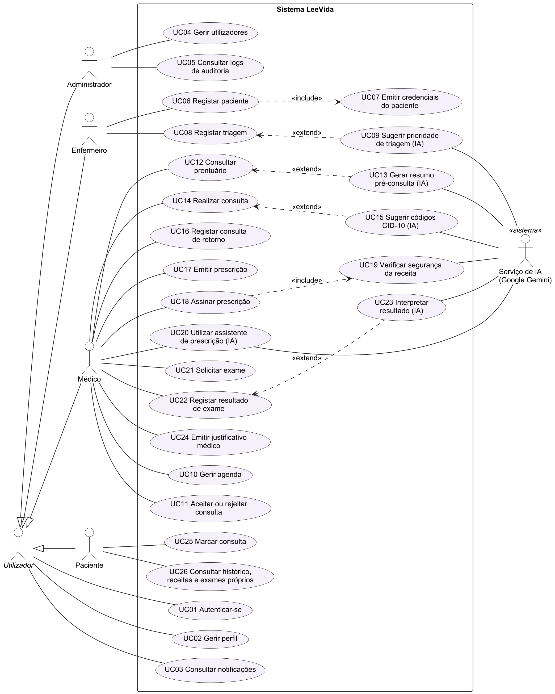
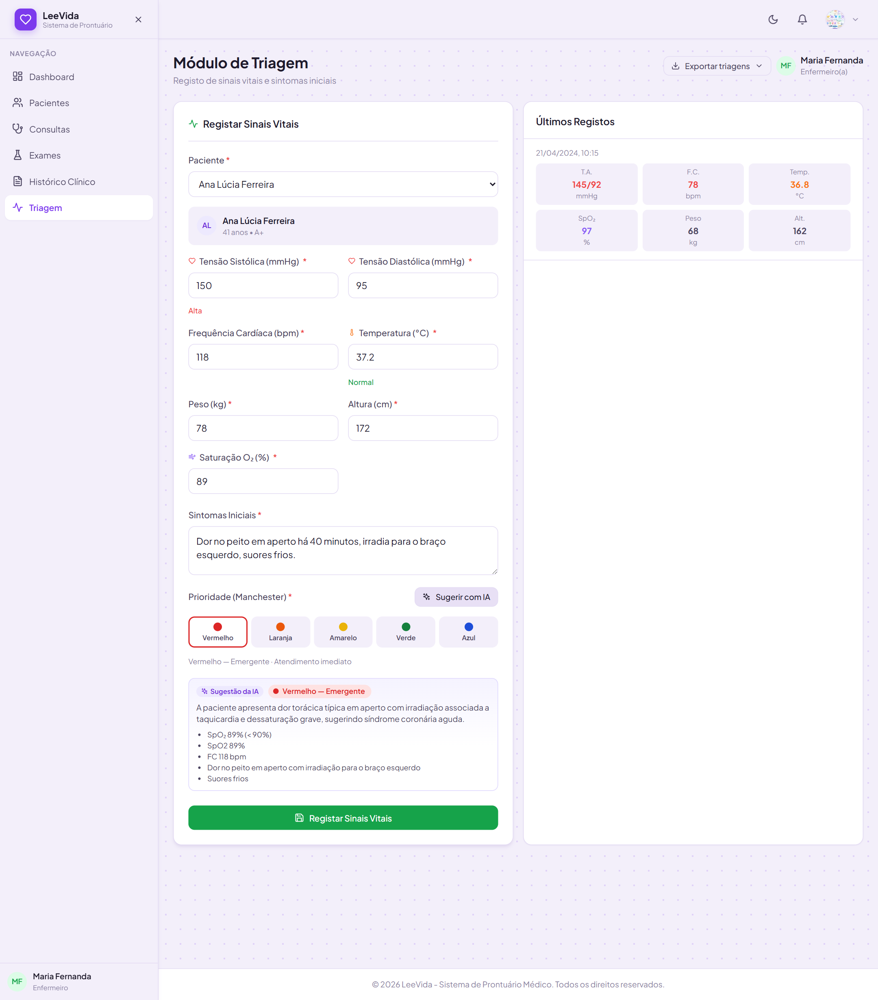
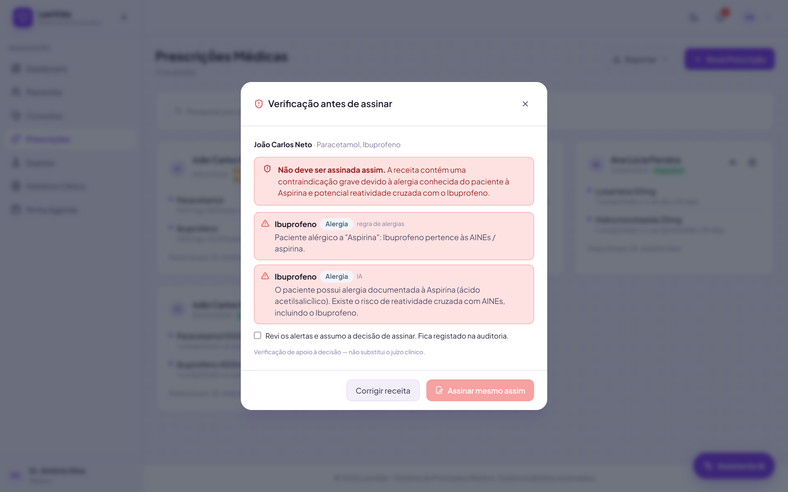

# LeeVida — Trabalho de Conclusão de Curso

**Desenvolvimento de um Sistema de Prontuário Médico para Pequenas Clínicas em Angola: Estudo de Caso na Clínica EmiPharma, Caála, Huambo**

Nancylee Danila Tome Jamba · Engenharia Informática · Instituto Superior Politécnico de Tecnologias e Ciências (ISPTEC) · Orientador: Judson Paiva · 2026

Este repositório reúne a monografia e todos os artefactos produzidos no trabalho: diagramas UML (imagens e código-fonte), requisitos, histórias de utilizador, cronograma, capturas de ecrã do sistema, documentação das funcionalidades de inteligência artificial e as evidências da investigação (entrevistas, guião e questionário).

## Monografia

| Ficheiro | Descrição |
|---|---|
| [TCC-Nancylee-Jamba-LeeVida.pdf](monografia/TCC-Nancylee-Jamba-LeeVida.pdf) | Versão para leitura |
| [TCC-Nancylee-Jamba-LeeVida.docx](monografia/TCC-Nancylee-Jamba-LeeVida.docx) | Versão editável (Word) |

## Estrutura

```
monografia/            a monografia em PDF e Word
artefactos/
  uml/fontes/          código-fonte PlantUML dos diagramas (.puml)
  uml/imagens/         diagramas UML em PNG (200 ppp)
  requisitos/          histórias de utilizador, backlog, releases, requisitos,
                       casos de uso, classes, RBAC e IA (Markdown)
  cronograma/          cronograma de actividades (Gantt, Fev.–Nov. 2026)
  ia/                  documentação técnica da IA no LeeVida
  graficos/            gráfico dos resultados do inquérito
capturas-de-ecra/      capturas do protótipo, numeradas como na monografia
evidencias/
  entrevistas/         gravações, transcrições e resumos das entrevistas
  guiao-entrevista/    guião das entrevistas semiestruturadas
  questionario/        questionário aplicado e exportação das respostas
  clinica/             fotografias e documentos da Clínica EmiPharma
```

## Diagramas UML

Modelados em UML 2.5.1 com [PlantUML](https://plantuml.com) e [Graphviz](https://graphviz.org).

| Figura | Diagrama | Imagem | Fonte |
|---|---|---|---|
| 4 | Casos de uso | [PNG](artefactos/uml/imagens/01-casos-de-uso.png) | [.puml](artefactos/uml/fontes/01-casos-de-uso.puml) |
| 5 | Classes do domínio | [PNG](artefactos/uml/imagens/02-classes.png) | [.puml](artefactos/uml/fontes/02-classes.puml) |
| 6 | Sequência: consulta, prescrição e verificação | [PNG](artefactos/uml/imagens/03-seq-consulta-prescricao.png) | [.puml](artefactos/uml/fontes/03-seq-consulta-prescricao.puml) |
| 7 | Sequência: triagem com IA | [PNG](artefactos/uml/imagens/04-seq-triagem-ia.png) | [.puml](artefactos/uml/fontes/04-seq-triagem-ia.puml) |
| 8 | Actividades: fluxo de atendimento | [PNG](artefactos/uml/imagens/05-actividades-atendimento.png) | [.puml](artefactos/uml/fontes/05-actividades-atendimento.puml) |
| 9 | Máquina de estados da consulta | [PNG](artefactos/uml/imagens/06-estados-consulta.png) | [.puml](artefactos/uml/fontes/06-estados-consulta.puml) |
| 10 | Componentes (arquitectura) | [PNG](artefactos/uml/imagens/07-componentes.png) | [.puml](artefactos/uml/fontes/07-componentes.puml) |
| 28 | Implantação | [PNG](artefactos/uml/imagens/08-implantacao.png) | [.puml](artefactos/uml/fontes/08-implantacao.puml) |



## Artefactos de engenharia de software

- [Histórias de utilizador, backlog e releases](artefactos/requisitos/historias-e-backlog.md)
- [Requisitos funcionais e não funcionais](artefactos/requisitos/requisitos.md)
- [Casos de uso e classes do domínio](artefactos/requisitos/casos-de-uso-e-classes.md)
- [Permissões (RBAC) e inteligência artificial](artefactos/requisitos/seguranca-e-ia.md)
- [Cronograma de actividades](artefactos/cronograma/cronograma.md)
- [Inteligência Artificial no LeeVida (PDF)](artefactos/ia/IA-no-LeeVida.pdf)

## O sistema LeeVida

Aplicação web de prontuário clínico com quatro perfis (administrador, médico, enfermeiro e paciente): registo de pacientes, triagem pela Escala de Manchester, consultas e fila de atendimento por prioridade, prescrições com verificação de segurança, exames com detecção de valores críticos, agenda médica, portal do paciente, notificações em tempo real e registo de auditoria. Integra IA generativa (Google Gemini) como apoio à decisão clínica, sempre com confirmação do profissional, regras clínicas determinísticas e dados anonimizados.

**Tecnologias:** React, TypeScript, Vite, Tailwind CSS · NestJS, Prisma, PostgreSQL, JWT · Google Gemini API.

| | |
|---|---|
|  |  |
| Sugestão de prioridade de triagem pela IA | Verificação de segurança da receita |

Todas as capturas estão em [`capturas-de-ecra/`](capturas-de-ecra/), com o número da figura correspondente na monografia. Os dados apresentados são fictícios (dados de demonstração).

## Evidências da investigação

Ver [`evidencias/`](evidencias/README.md): entrevistas com o Dr. Herculano Daniel e a Enf.ª Imaculada Bandarrinha, guião de entrevista, questionário aplicado à população (90 respostas) e material da Clínica EmiPharma.

## Direitos

© 2026 Nancylee Danila Tome Jamba. Material académico disponibilizado para consulta. A reprodução de partes do trabalho deve citar a autora.
